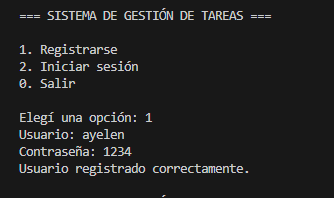
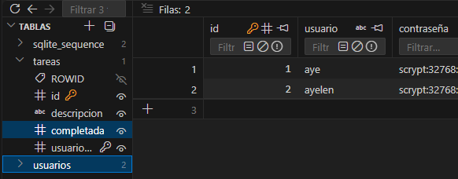
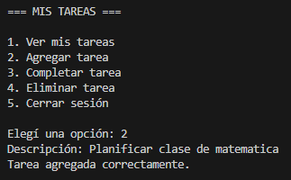
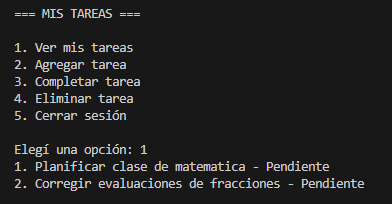
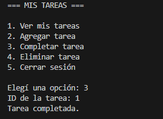
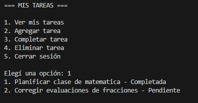
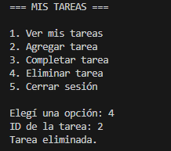
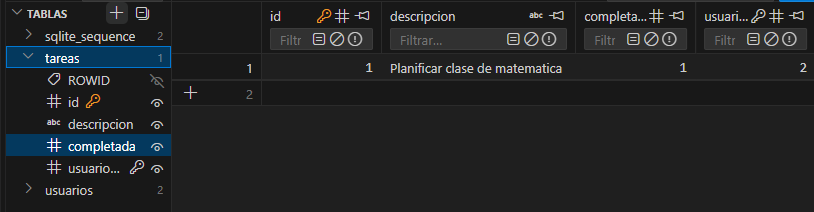
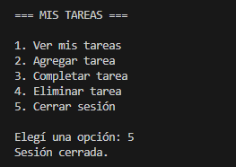
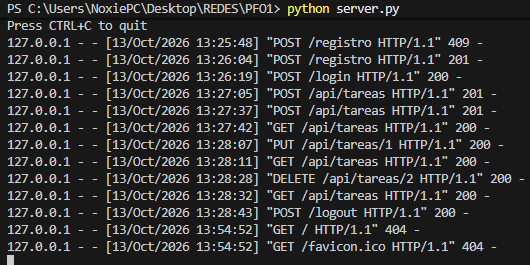

# PFO2: Sistema de Gestión de Tareas con API y Base de Datos

## Introducción

En este segundo trabajo práctico realicé un sistema sencillo para organizar tareas. Para hacerlo utilicé Python, Flask y una base de datos SQLite.

La idea fue continuar con lo aprendido en el primer trabajo, pero esta vez utilizando una API para comunicar el cliente con el servidor. También trabajé con el registro de usuarios, el inicio de sesión y la protección de contraseñas.

## Herramientas utilizadas

- **Python:** es el lenguaje que utilicé para programar el servidor y el cliente.
- **Flask:** permite crear la API que recibe las solicitudes del cliente.
- **Requests:** permite enviar las solicitudes desde el cliente de consola al servidor.
- **SQLite:** guarda los usuarios y las tareas en un archivo de base de datos.
- **Werkzeug:** permite proteger las contraseñas mediante hash y verificarlas al iniciar sesión.

## ¿Cómo funciona?

El usuario utiliza el cliente de consola para registrarse, iniciar sesión y organizar sus tareas. El cliente se comunica con el servidor Flask, que se encarga de guardar o consultar los datos en SQLite.

El servidor está en `server.py` y el cliente en `client.py`. La base de datos se llama `tareas.db` y se crea automáticamente al iniciar el servidor si todavía no existe. Tiene dos tablas: `usuarios` y `tareas`.

Cada usuario puede ver, completar y eliminar solamente sus propias tareas. El cliente mantiene la sesión iniciada mientras se utilizan las opciones del programa.

Las contraseñas se guardan protegidas mediante hash, no como texto original. Además, el servidor tiene la ruta `/tareas`, que muestra un HTML de bienvenida o indica que es necesario iniciar sesión.

## Funciones del programa

- **Registrarse:** crear un usuario con una contraseña. No permite repetir un nombre de usuario.
- **Iniciar sesión:** ingresar con los datos de un usuario registrado.
- **Ver tareas:** consultar las tareas propias y su estado.
- **Agregar una tarea:** guardar una nueva tarea con una descripción.
- **Completar una tarea:** marcar una tarea como completada usando su ID.
- **Eliminar una tarea:** borrar una tarea propia usando su ID.
- **Cerrar sesión:** volver al menú inicial.

## Cómo ejecutar el programa

Abrir la carpeta del proyecto en VS Code. Desde **Terminal > Nueva terminal**, instalar las dependencias indicadas en `requirements.txt`:

```powershell
python -m pip install -r requirements.txt
```

Después, iniciar el servidor:

```powershell
python server.py
```

Dejar esa terminal abierta y abrir otra terminal en la misma carpeta. Allí ejecutar el cliente:

```powershell
python client.py
```

Primero hay que registrarse y luego iniciar sesión para acceder al menú de tareas. 
Para salir del cliente, cerrar sesión y elegir la opción `0`. Para detener el servidor, presionar `Ctrl+C` en su terminal. El programa se utiliza de forma local, en la misma computadora.

## Capturas de pantalla

### 1. Registro correcto



### 2. Intento de registrar un usuario existente


### 3. Base de datos de usuarios



### 4. Agregar una tarea



### 5. Ver las tareas



### 6. Completar una tarea



### 7. Ver las tareas completadas



### 8. Eliminar una tarea



### 9. Base de datos de tareas



### 10. Cerrar sesión



### 11. Servidor en funcionamiento

En esta captura se pueden ver las solicitudes que recibió el servidor durante las pruebas del programa. Se realizaron operaciones para registrar usuarios, iniciar sesión, agregar, consultar, completar y eliminar tareas.

También se muestran las respuestas del servidor, que permiten comprobar si las operaciones se realizaron correctamente.



## Respuestas conceptuales

### ¿Por qué es importante hashear las contraseñas?

Es importante para no guardar las contraseñas originales en la base de datos. Si alguien consigue leerla, no encuentra directamente las claves de los usuarios. Al iniciar sesión, el programa comprueba la contraseña usando el hash guardado.

### ¿Qué ventajas tiene SQLite para este proyecto?

SQLite es fácil de usar y no necesita un servidor de base de datos aparte. Guarda la información en un archivo y Python incluye la herramienta `sqlite3` para trabajar con ella. Es una opción práctica para un proyecto pequeño que funciona en una computadora.

## Uso de inteligencia artificial

Para realizar este trabajo utilicé herramientas de inteligencia artificial como apoyo para adaptar el código del primer proyecto, resolver algunos errores y mejorar la documentación. 

## Conclusión

Con este proyecto aprendí a comunicar un cliente con un servidor mediante una API y a guardar usuarios y tareas en SQLite. También pude practicar el uso de sesiones y comprender por qué las contraseñas deben guardarse protegidas.

## Datos del trabajo

**Asunción Maria Ayelen**  
**Programación sobre Redes**  
**2026**
