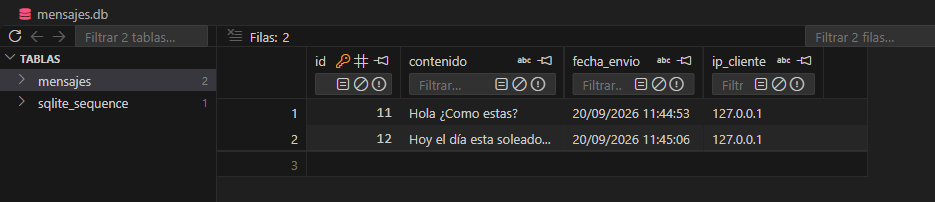
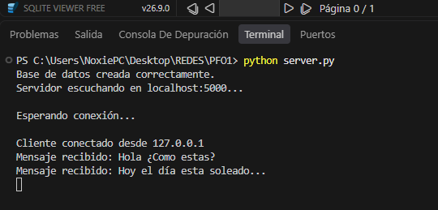
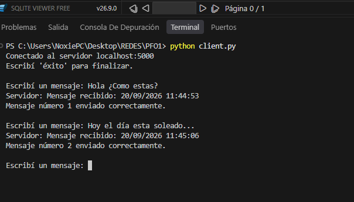
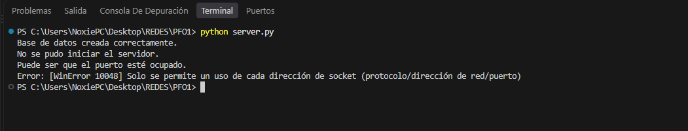
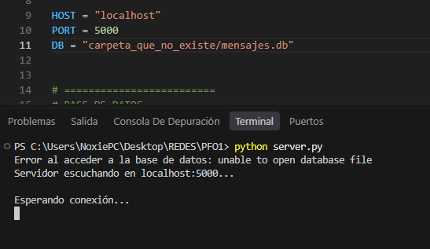

# Chat básico Cliente-Servidor con Sockets y SQLite

## Descripción
Este proyecto corresponde a un trabajo práctico obligatorio realizado en Python, donde se trabajó con un modelo básico de cliente-servidor utilizando sockets.

El cliente permite enviar varios mensajes y el servidor los recibe, los guarda en una base de datos y devuelve una confirmación con la fecha y hora en que fueron recibidos.

## Tecnologías utilizadas

- Python
- `socket`
- `sqlite3`
- `datetime`
- SQLite

## Archivos del proyecto

- `server.py`: contiene el servidor y se encarga de recibir y guardar los mensajes.
- `client.py`: permite conectarse al servidor y enviar mensajes.
- `mensajes.db`: base de datos donde se almacenan los mensajes.
- `borrar_db.py`: permite borrar los mensajes guardados para realizar nuevas pruebas.

## Base de datos
Para guardar los mensajes se utilizó una base de datos SQLite llamada `mensajes.db`.

La tabla utilizada se llama `mensajes` y contiene los campos solicitados en la consigna:

- `id`: identifica cada mensaje.
- `contenido`: guarda el mensaje enviado.
- `fecha_envio`: guarda la fecha y hora.
- `ip_cliente`: guarda la IP del cliente.
Para poder visualizar mejor la base de datos desde Visual Studio Code utilicé el complemento **SQLite Viewer**.

Este complemento solamente se utilizó para poder ver de forma más clara los datos que se iban guardando.

### Captura de la base de datos

<p align="center">
  
</p>

## Limpieza de la base de datos
Durante las pruebas surgió la necesidad de dejar limpia la base de datos para volver a probar el programa desde cero.

Por eso agregué el archivo `borrar_db.py`, que permite borrar todos los mensajes almacenados sin eliminar la base de datos.

**Aclaración:** se borran todos los mensajes, no uno en particular.

## Cómo ejecutar el proyecto
Primero se inicia el servidor:

```
python server.py
```
Después se abre otra terminal y se inicia el cliente:

```
python client.py
```
Una vez conectado, el cliente puede enviar varios mensajes.

Para finalizar la conexión se escribe:

```
éxito
```

## Capturas de funcionamiento

### Servidor iniciado

<p align="center">
  
</p>

### Cliente enviando mensajes

<p align="center">
  
</p>

### Prueba de puerto ocupado

<p align="center">
  
</p>

### Error al abrir la base de datos

<p align="center">
  
</p>

## En esta entrega
En esta versión del trabajo se implementó:

- La conexión entre cliente y servidor.
- El envío de varios mensajes.
- El guardado de los mensajes en SQLite.
- La fecha y hora de recepción.
- La IP del cliente.
- Un contador de mensajes enviados.
- Manejo básico de errores.
- Una opción sencilla para limpiar la base de datos.
El servidor trabaja con un cliente por vez.

## Posibles mejoras a futuro
En esta entrega no se implementaron funciones más avanzadas para mantener el proyecto sencillo y acorde a lo trabajado.

A futuro se podría agregar:

- La posibilidad de conectar varios clientes al mismo tiempo.
- Una interfaz para no trabajar solamente desde la terminal.
- Una opción para consultar los mensajes guardados desde el mismo programa.
- La posibilidad de borrar un mensaje específico y no todos juntos.
Estas funciones no forman parte de esta versión, pero podrían incorporarse como mejoras posteriores.

## Datos del trabajo
**Asunción Maria Ayelen**
**Programación sobre redes**
**2026** 
